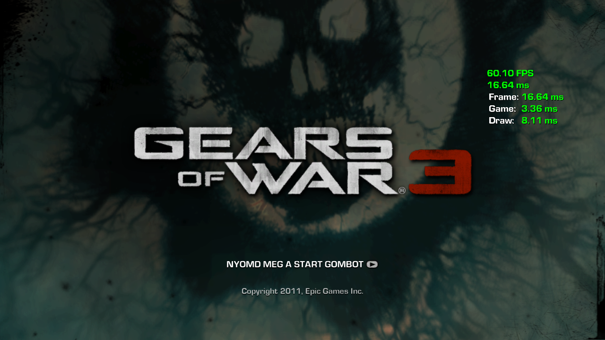
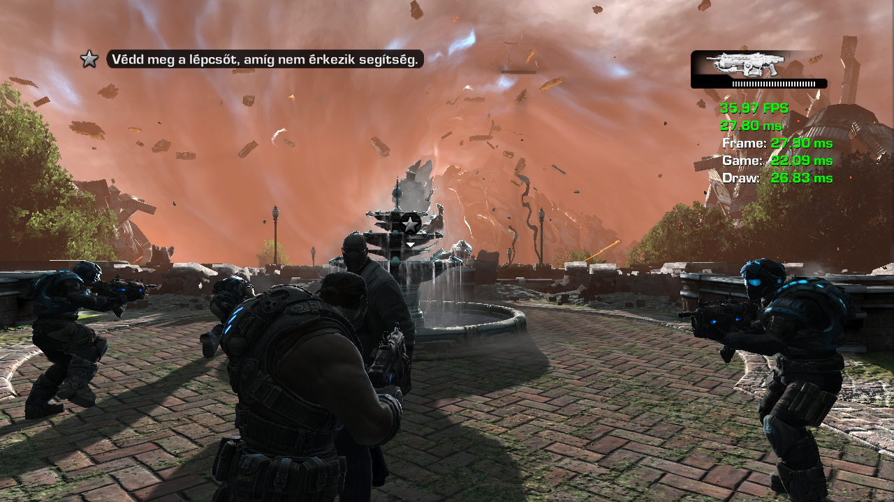

<p align="center"></p>

<h1 align="center">XPatch360</h1>

<p align="center">
Xenia patches on real Xbox 360 hardware. Dashlaunch plugin + Aurora menu, works with title updates, no XEX modding.
</p>

<p align="center"><b>v1.1</b> · <a href="CHANGELOG.md">What's new</a></p>

---

## What it does

[Xenia Canary](https://github.com/xenia-canary/xenia-canary) has a large community collection of
[game patches](https://github.com/xenia-canary/game-patches): FPS unlocks, skipped intros, disabled motion blur,
depth of field, shadows and more. XPatch360 brings them to real hardware (RGH / JTAG):

- **Dashlaunch plugin** (`XPatch360.xex`): when a game starts, the console loads it **with its title update** as
  usual, then the plugin writes the enabled patches into memory. No XEX editing, no merging the TU into the game.
- **Version check by hash**: the plugin computes the same module hash Xenia does and applies a patch file only if
  the file lists that hash. A file made for another TU, region or disc is skipped instead of writing to wrong
  addresses.
- **Aurora script**: *Utilities → XPatch360* lists your installed games, the patch files of each game by TU, and
  lets you turn every patch on or off. Selecting a patch shows its author and description first.
- **Notification** when the game starts: `XPatch360: 3 patches applied successfully`, `... 1 applied, 1 failed`,
  `... 2 patches skipped - game version doesn't match`.
- **Log**: `Hdd:\Patches\XPatch360.log` lists the running version, its hash, every patch applied and every error.

The patch files are the Xenia ones, unchanged except for the file name and `is_enabled`.

<p align="center">
  
  
</p>
<p align="center"><sub>Gears of War 3, TU6, on a real console: Unlock FPS, Show FPS and a few post-processing effects
switched off.</sub></p>

## Requirements

- Xbox 360 with RGH or JTAG, **Dashlaunch**
- **Aurora** dashboard (for the on/off menu; the plugin works without it if you edit `is_enabled` by hand)

## Install

XPatch360 is distributed as source only: a built `XPatch360.xex` would contain Microsoft SDK code, so there is no
binary release. Build the plugin yourself first (see [Building the plugin](#building-the-plugin)), then:

1. Copy your `XPatch360.xex` to the console, e.g. `Hdd:\XPatch360.xex`.
2. Add it to a free plugin slot in `launch.ini`:
   ```ini
   [Plugins]
   plugin3 = Hdd:\XPatch360.xex
   ```
3. Download this repository (*Code → Download ZIP*) and copy its `aurora/XPatch360` folder into the
   `User\Scripts\Utility\` folder **inside your Aurora folder**, so that you get:
   ```
   Aurora\User\Scripts\Utility\XPatch360\main.lua
   Aurora\User\Scripts\Utility\XPatch360\icon.png
   ```
4. Restart the console (Dashlaunch loads plugins at boot; Aurora reads scripts when it starts).
5. In Aurora open **Utilities**, select **XPatch360** and in its details tick the permissions **File system** and
   **Content** (Content is used to list only your installed games).
6. Check that `Hdd:\Patches\XPatch360.log` exists and starts with `XPatch360 v1.1 started`: the plugin is running.

### Updating from v1.0 (XPatch)

The project was renamed, and so were its files on the console. Your patch files in `Hdd:\Patches\` stay as they are.

1. Replace `XPatch.xex` with the new `XPatch360.xex` and update the plugin line in `launch.ini`.
2. Delete `Aurora\User\Scripts\Utility\XPatch\`, copy in `XPatch360\`, and tick the permissions again.
3. `XPatch.log` in `Hdd:\Patches\` can be deleted.

## Adding patches

The patch files are **not** included here: they belong to their authors in
[xenia-canary/game-patches](https://github.com/xenia-canary/game-patches). Get them from there and convert them:

1. Download the repository as a ZIP (*Code → Download ZIP*) and unpack the `patches` folder.
2. Convert the names for the console's file system (ASCII only, max 42 characters) and switch every patch off:
   ```powershell
   powershell -ExecutionPolicy Bypass -File tools\Convert-XeniaPatches.ps1 -Src "C:\...\game-patches\patches" -Dst "C:\...\Patches_xbox"
   ```
   `545408A7 - Grand Theft Auto V (TU27).patch.toml` becomes `545408A7 (TU27) Grand Theft Auto V.toml`.
   The game name in Aurora comes from `title_name` inside the file, so a shortened file name doesn't matter.
3. Copy the **contents** of `Patches_xbox` to `Hdd:\Patches\` (FTP or Xbox 360 Neighborhood).

## Usage

1. Aurora → **Utilities → XPatch360**.
2. Pick a game (only installed games are listed; *Show all games* lists everything).
3. Pick the file that matches the TU you play (`Base game (no TU)`, `TU5`, `TU27`...).
4. Select a patch: a window shows its author and description, with **Turn ON** / **Turn OFF** and **Back**.
   Changes take effect the next time the game starts.

Descriptions that only point to the Xenia README (e.g. *"See note about framerate patches in the README."*, which is
about emulator settings) are replaced with a note on what the patch means on a console.

<p align="center">
  
  
  
</p>
<p align="center">
  
  
</p>

## How the game version is checked

Every Xenia patch file lists the hash of the game version it was made for:

```toml
title_name = "Gears of War 3"
title_id = "4D5308AB"
hash = "7775898137CE1CE3"
```

Xenia computes this hash (XXH3-64) over the game's code after loading the title update. XPatch360 computes the same
hash on the console, the way Xenia does it, and applies a file only if its `hash` matches. A match means the
addresses in the file are the ones of the running game, so a wrong file can't crash the game or leave a black
screen. Files that don't match are skipped and named in the log:

```
[4D5308AB] running TU6
[4D5308AB] module hash 7775898137CE1CE3 (computed, cached for next time)
[4D5308AB] 5 patches on, 11 writes, 0 errors (Hdd:\Patches\4D5308AB (TU6) Gears of (DiscTU1XBL).toml)
```

**Cache.** Computing the hash takes a moment, and some patches (e.g. *Skip Legal Screens*) must be in place before the
game runs that code. So the hash of each game version is saved in `Hdd:\Patches\XPatch360.cache`. On the next start
the plugin patches right away and checks the hash afterwards; if it doesn't match after all (e.g. a new TU), it
restores the original bytes, updates the cache and decides again. The cache can be deleted at any time; it is
rebuilt on the next start.

**Fallback.** If the hash can't be computed, the plugin falls back to the v1.0 check: the `(TUn)` tag in the file
name must match the running TU (a file without a tag counts as the base game), and a `media_id` in the file must
match the disc. The TU is the *build* field of the title's version: GTA IV `00000805` = TU8, GTA V `00001B09` = TU27.

Hashes checked against the Xenia files on a real console:

| Game | TU | Hash |
|---|---|---|
| Grand Theft Auto IV | 8 | `797B4775D3BC9853` |
| Gears of War | 5 | `34849A59634915F6` |
| Gears of War 3 | 6 | `7775898137CE1CE3` |

## Things to know

- **Not every Xenia patch suits real hardware.** They are made and tested on an emulator running on a PC.
  The hash check makes sure a patch goes to the right addresses, not that the console can handle it. Seen so far:
  - Gears of War 3 TU6: *Performance Patch, Option A: Low Settings (No Dynamic Shadows)* freezes the game.
  - GTA V: *Skip Intro Logos* also hides the loading screen (the game still loads).
  - GTA IV: FPS unlocks give uneven frame times where the console can't hold a higher rate.

  If a game misbehaves, turn patches back on one at a time.
- The console outputs 60 Hz, so FPS above 60 isn't visible.
- Xbox 360 Neighborhood may show an old cached copy of `XPatch360.log`; refresh (F5) or copy it out before opening.

## Tested

| Game | TU | Patches |
|---|---|---|
| Grand Theft Auto IV | 0, 8 | Skip Legal Screens, Disable blur filter, Unlock FPS |
| Grand Theft Auto V | 27 | FPS Uncap, Skip Intro Logos (see above) |
| Gears of War | 5 | 60 FPS, Disable Motion Blur, Upscaling Fix, 16x Anisotropic Filtering, Show Frametime |
| Gears of War 3 | 6 | Unlock FPS, Show FPS, Occlusion Query Fix, Disable Motion Blur / Depth of Field / Bloom, Resolution Scaling Fix |
| Forza Horizon | 4 | Disable Motion Blur / Depth of Field / Shadows |
| Bionicle Heroes | 0 | 60 FPS |

## Building the plugin

You need:

- **Visual Studio 2010 Professional** (or higher) **with SP1**. Newer Visual Studio versions don't work with the
  Xbox 360 SDK; the Express edition isn't enough.
- **Xbox 360 SDK** (XDK) 2.0.21256 with the **Full Installation** (installs the compiler; it needs VS2010 present).
  The XDK is Microsoft's and is not part of this repository.
- **xextool** 6.6 (xorloser) to turn the devkit XEX into a retail one.

Then, from the **Xbox 360 Command Prompt** in `plugin\` (set the `XEXTOOL` path at the top of `build.bat` first):

```bat
build.bat
```

What matters for a Dashlaunch plugin, and why the build looks like this:

| Setting | Why |
|---|---|
| `/DLL` + `xex.xml` with `<sysdll />` | a system DLL; without it the XEX is flagged as a title and Dashlaunch won't load it |
| `/ALIGN:128,4096` | 4 KB pages; images with 4 KB pages live at `0x9xxxxxxx`, where plugins go |
| `/BASE:0x91D00000` | the loader never relocates DLLs; pick an address no other plugin uses |
| `xextool -m r -r a -e u` | retail format, unencrypted, no media/region limits |

The linker writes the XEX under the `/OUT` name (`XPatch360.dll`) and the PE as `XPatch360.pe`; `build.bat` copies
it to `XPatch360.xex`. Check the result with `xextool -l XPatch360.xex`: *Retail*, *Not-Encrypted*, *DLL Module*, no
*Title Module*, *Load Address 91D00000*, *Page Size 1000*.

### Code layout

- `plugin/main.cpp`: the whole plugin. A system thread watches the current title ID; on a change it reads the
  execution ID (title ID, version, media ID), computes the module hash, finds `Hdd:\Patches\<TITLEID>*.toml`,
  parses the Xenia patch format (`be8/16/32/64`, `f32/f64`, `string`, `u16string`, `array`), writes the enabled
  patches, flushes the data and instruction caches (`dcbst` / `icbi`), logs, and shows the notification
  (`XNotifyQueueUICustom`, xam.xex #656) from a title thread.
- **Module hash** (`ComputeModuleHash`): XXH3-64 over the code pages of the title image, as in Xenia's
  `user_module.cc`. Xenia hashes the code after it has rewritten the imports, so the plugin hashes the console's
  import thunks and function descriptors as Xenia's values (`44000042 4E800020 60000000 60000000` / `DEADC0DE`).
  A self-test at start checks that XXH3 gives the same results as on a PC.
- `plugin/xxhash.h`: [xxHash](https://github.com/Cyan4973/xxHash), with four MSVC-only branches turned off for the
  Xbox 360 compiler (marked `XPatch360:`).
- `aurora/XPatch360/main.lua`: the Aurora utility script; it edits the `is_enabled` lines of the `.toml` files.
- `tools/Convert-XeniaPatches.ps1`: file-name conversion for the console.

## Credits

- **Patches**: the contributors of [xenia-canary/game-patches](https://github.com/xenia-canary/game-patches).
  XPatch360 only applies their work on real hardware.
- **Xenia / Xenia Canary** for the patch format and the module hash.
- **xxHash** by Yann Collet, BSD 2-Clause License (see the top of `plugin/xxhash.h`).
- **Aurora** (Phoenix) for the scripting API, **Dashlaunch** for plugin loading, **xorloser** for xextool.
- XPatch360 by **bobber360 & Claude**.

## License

The code in this repository (plugin, Aurora script, tools) is under the [MIT License](LICENSE), except
`plugin/xxhash.h`, which keeps its own BSD 2-Clause License.
The patch files belong to their respective authors and are not distributed here.
