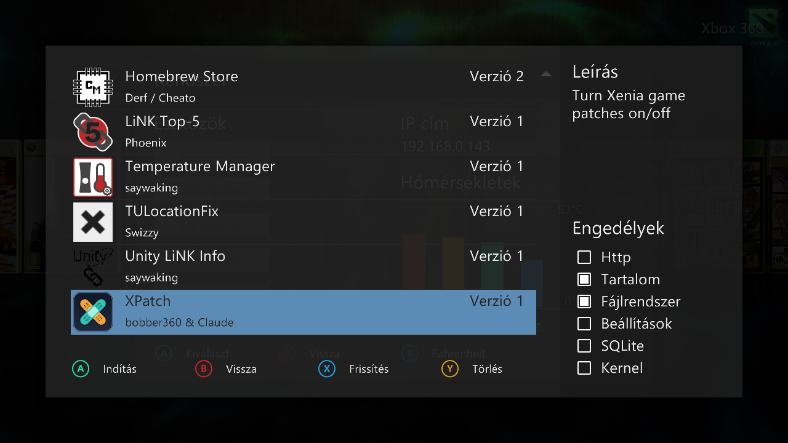
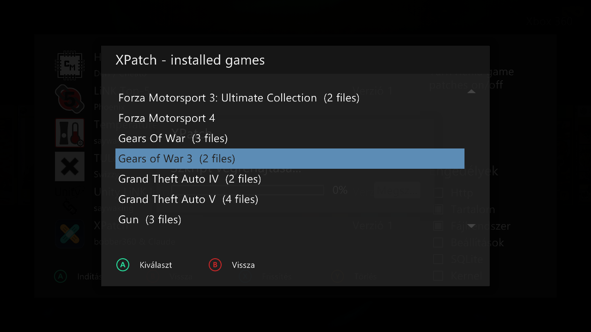
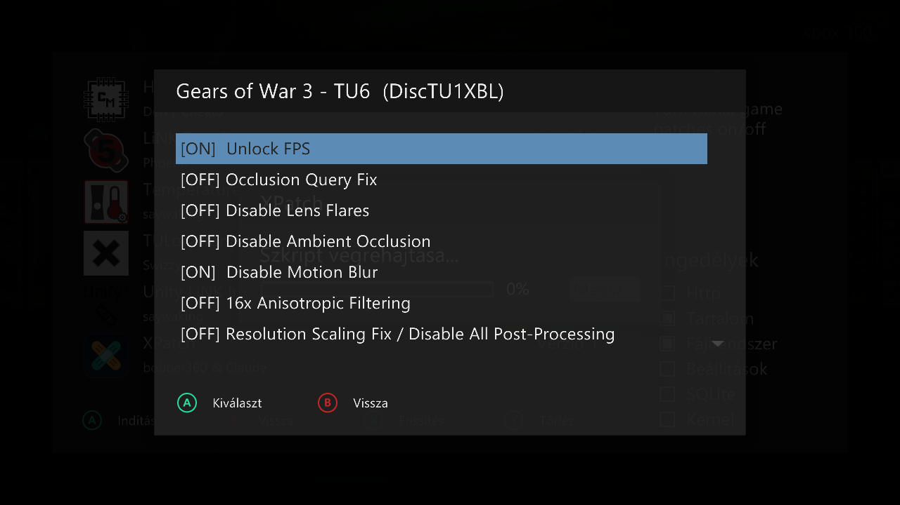
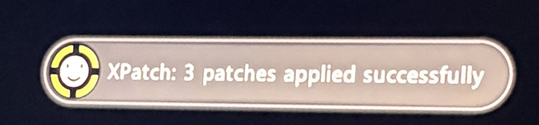

<p align="center"></p>

<h1 align="center">XPatch - Xenia Patches for Xbox 360 RGH</h1>

<p align="center">
Xenia Canary game patches on a real Xbox 360 (RGH / JTAG), applied in memory after the title update loads,<br>
switched on and off from Aurora.
</p>

---

## What it does

[Xenia Canary](https://github.com/xenia-canary/xenia-canary) has a large community collection of
[game patches](https://github.com/xenia-canary/game-patches): FPS unlocks, skipped intros, disabled motion blur,
depth of field, shadows and more. XPatch brings them to real hardware:

- **Dashlaunch plugin** (`XPatch.xex`): when a game starts, the console loads it **with its title update** as usual,
  then the plugin writes the enabled patches into memory. No XEX editing, no merging the TU into the game.
- **Aurora script**: *Utilities → XPatch* lists your installed games, the patch files of each game by TU, and lets you
  turn every patch on or off.
- **TU check**: a `(TU27)` patch file is applied only while TU27 is running; a file without a TU tag only on the base
  game. Patches made for another version are skipped instead of writing to wrong addresses.
- **Notification** when the game starts: `XPatch: 3 patches applied successfully`, `... 1 applied, 1 failed`,
  `... 2 patches skipped (made for another TU)`.
- **Log**: `Hdd:\Patches\XPatch.log` lists the running version, every patch applied and every error.

The patch files are the Xenia ones, unchanged except for the file name and `is_enabled`.

<p align="center">
  
  
</p>
<p align="center"><sub>Gears of War 3, TU6, on a real console: Unlock FPS, Show FPS and a few post-processing effects
switched off.</sub></p>

## Requirements

- Xbox 360 with RGH or JTAG, **Dashlaunch**
- **Aurora** dashboard (for the on/off menu; the plugin works without it if you edit `is_enabled` by hand)

## Install

XPatch is distributed as source only: a built `XPatch.xex` would contain Microsoft SDK code, so there is no binary
release. Build the plugin yourself first (see [Building the plugin](#building-the-plugin)), then:

1. Copy your `XPatch.xex` to the console, e.g. `Hdd:\XPatch.xex`.
2. Add it to a free plugin slot in `launch.ini`:
   ```ini
   [Plugins]
   plugin3 = Hdd:\XPatch.xex
   ```
3. Download this repository (*Code → Download ZIP*) and copy its `aurora/XPatch` folder into the
   `User\Scripts\Utility\` folder **inside your Aurora folder**, so that you get:
   ```
   Aurora\User\Scripts\Utility\XPatch\main.lua
   Aurora\User\Scripts\Utility\XPatch\icon.png
   ```
4. Restart the console (Dashlaunch loads plugins at boot; Aurora reads scripts when it starts).
5. In Aurora open **Utilities**, select **XPatch** and in its details tick the permissions **File system** and
   **Content** (Content is used to list only your installed games).
6. Check that `Hdd:\Patches\XPatch.log` exists and starts with `XPatch started`: the plugin is running.

## Adding patches

The patch files are **not** included here: they belong to their authors in
[xenia-canary/game-patches](https://github.com/xenia-canary/game-patches). Get them from there and convert them:

1. Download the repository as a ZIP (*Code → Download ZIP*) and unpack the `patches` folder.
2. Convert the names for the console's file system (ASCII only, max 42 characters) and switch every patch off:
   ```powershell
   powershell -ExecutionPolicy Bypass -File tools\Convert-XeniaPatches.ps1 -Src "C:\...\game-patches\patches" -Dst "C:\...\Patches_xbox"
   ```
   `545408A7 - Grand Theft Auto V (TU27).patch.toml` becomes `545408A7 (TU27) Grand Theft Auto V.toml`.
   The game name in Aurora comes from `title_name` inside the file, so a shortened file name doesn't matter;
   the `(TUn)` tag right after the title ID does.
3. Copy the **contents** of `Patches_xbox` to `Hdd:\Patches\` (FTP or Xbox 360 Neighborhood).

## Usage

1. Aurora → **Utilities → XPatch**.
2. Pick a game (only installed games are listed; *Show all games* lists everything).
3. Pick the file that matches the TU you play (`Base game (no TU)`, `TU5`, `TU27`...).
4. Select a patch to toggle `[ON]` / `[OFF]`. Changes take effect the next time the game starts.

<p align="center">
  
  
  
</p>

When the game starts, the result shows up as a notification:

<p align="center"></p>

## How the TU is detected

The plugin reads the running title's version and takes its *build* field as the TU number:

| Game | Version | TU |
|---|---|---|
| GTA IV | `00000805` | 8 |
| GTA V | `00001B09` | 27 |
| Gears of War | `00000501` | 5 |
| Gears of War 3 | `0000060B` | 6 |
| Forza Horizon | `0000040A` | 4 |
| any base game | `000000xx` | 0 |

If a game numbers its versions differently, its matching file would be reported as skipped; the
`running TU..` line in the log shows what the plugin detected.

## Things to know

- **Not every Xenia patch suits real hardware.** They are made and tested on an emulator running on a PC.
  Examples seen so far: GTA V *Skip Intro Logos* also hides the loading screen (the game still loads);
  FPS unlocks can give uneven frame times where the console can't hold a higher rate (GTA IV).
  If a game misbehaves, turn patches back on one at a time.
- **Region and demo files** (`(Japan)`, `(E3Demo)`...) count as the base game for the TU check. They are rejected
  only if they contain a `media_id` that doesn't match your disc. Enable them only if you run that version.
- The plugin patches as soon as it sees the title start (it polls every 5 ms). A patch of code that runs in the very
  first moments could still be missed; so far *Skip Legal Screens* in GTA IV worked.
- Xbox 360 Neighborhood may show an old cached copy of `XPatch.log`; refresh (F5) or copy it out before opening.

## Tested

| Game | TU | Patches |
|---|---|---|
| Grand Theft Auto IV | 0, 8 | Skip Legal Screens, Disable blur filter, Unlock FPS |
| Grand Theft Auto V | 27 | FPS Uncap, Skip Intro Logos (see above) |
| Gears of War | 5 | 60 FPS, Show Frametime; with Disable Motion Blur |
| Gears of War 3 | 6 | Unlock FPS, Show FPS, Disable Motion Blur / Depth of Field / Bloom |
| Forza Horizon | 4 | Disable Motion Blur / Depth of Field / Shadows |
| Bionicle Heroes | 0 | 60 FPS |

## Building the plugin

You need:

- **Visual Studio 2010 Professional** (or higher) **with SP1**. Newer Visual Studio versions don't work with the
  Xbox 360 SDK; the Express edition isn't enough.
- **Xbox 360 SDK** (XDK) 2.0.21256 with the **Full Installation** (installs the compiler; it needs VS2010 present).
  The XDK is Microsoft's and is not part of this repository.
- **xextool** 6.6 (xorloser) to turn the devkit XEX into a retail one.

Then, from the **Xbox 360 Command Prompt** in `plugin\` (set the `XEXTOOL` path at the top of `build.bat` first):

```bat
build.bat
```

What matters for a Dashlaunch plugin, and why the build looks like this:

| Setting | Why |
|---|---|
| `/DLL` + `xex.xml` with `<sysdll />` | a system DLL; without it the XEX is flagged as a title and Dashlaunch won't load it |
| `/ALIGN:128,4096` | 4 KB pages; images with 4 KB pages live at `0x9xxxxxxx`, where plugins go |
| `/BASE:0x91D00000` | the loader never relocates DLLs; pick an address no other plugin uses |
| `xextool -m r -r a -e u` | retail format, unencrypted, no media/region limits |

The linker writes the XEX under the `/OUT` name (`XPatch.dll`) and the PE as `XPatch.pe`; `build.bat` copies it to
`XPatch.xex`. Check the result with `xextool -l XPatch.xex`: *Retail*, *Not-Encrypted*, *DLL Module*, no
*Title Module*, *Load Address 91D00000*, *Page Size 1000*.

### Code layout

- `plugin/main.cpp`: the whole plugin. A system thread watches the current title ID; on a change it reads the
  execution ID (title ID, version, media ID), finds `Hdd:\Patches\<TITLEID>*.toml`, parses the Xenia patch format
  (`be8/16/32/64`, `f32/f64`, `string`, `u16string`, `array`), writes the enabled patches, flushes the data and
  instruction caches (`dcbst` / `icbi`), logs, and shows the notification (`XNotifyQueueUICustom`, xam.xex #656).
- `aurora/XPatch/main.lua`: the Aurora utility script; it edits the `is_enabled` lines of the `.toml` files.
- `tools/Convert-XeniaPatches.ps1`: file-name conversion for the console.

## Credits

- **Patches**: the contributors of [xenia-canary/game-patches](https://github.com/xenia-canary/game-patches).
  XPatch only applies their work on real hardware.
- **Xenia / Xenia Canary** for the patch format.
- **Aurora** (Phoenix) for the scripting API, **Dashlaunch** for plugin loading, **xorloser** for xextool.
- XPatch by **bobber360 & Claude**.

## License

The code in this repository (plugin, Aurora script, tools) is under the [MIT License](LICENSE).
The patch files belong to their respective authors and are not distributed here.
