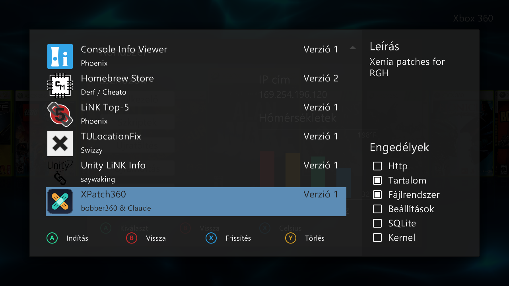
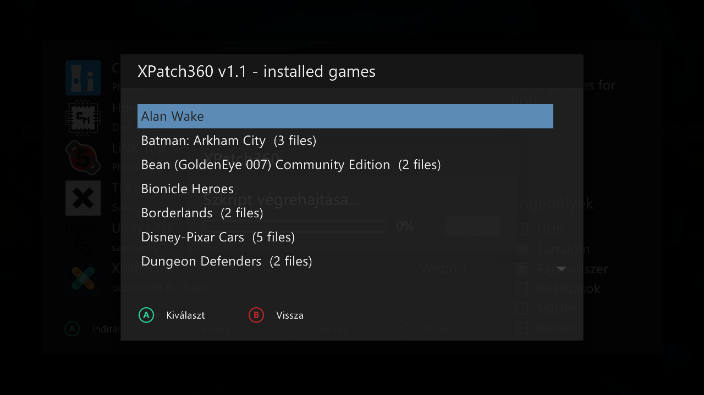
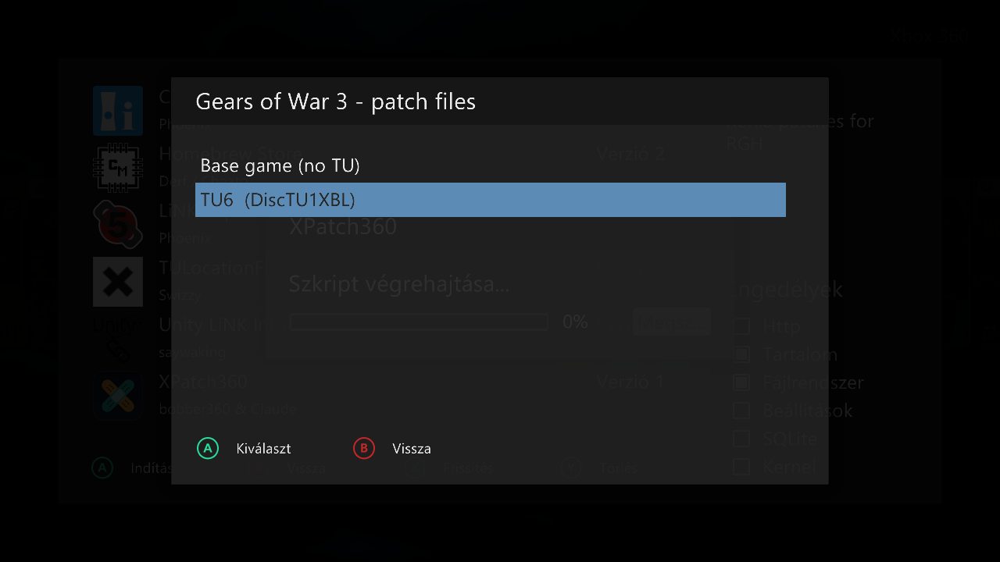
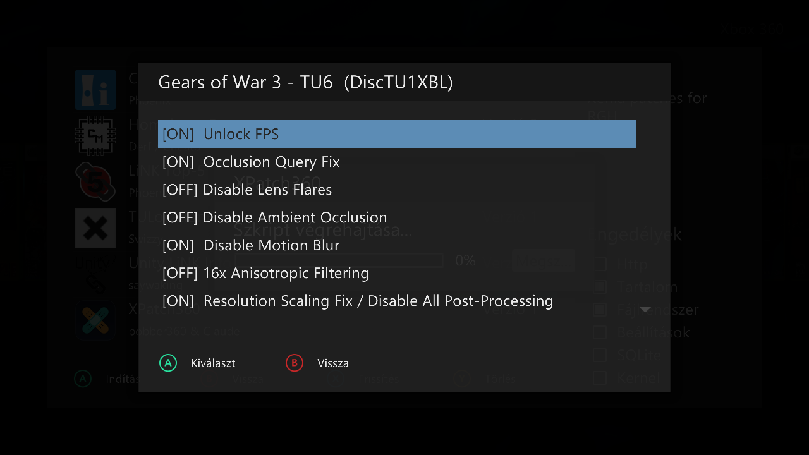
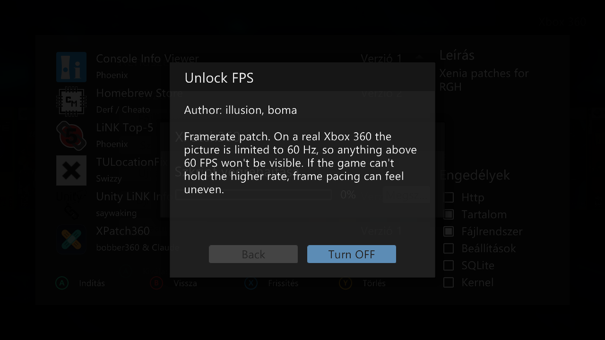

<p align="center"></p>

<h1 align="center">XPatch360</h1>

<p align="center">
Xenia patches on real Xbox 360 hardware. Dashlaunch plugin + Aurora menu, works with title updates, no XEX modding.
</p>

<p align="center"><b>v1.2</b> · <a href="CHANGELOG.md">What's new</a></p>

---

## What it does

[Xenia Canary](https://github.com/xenia-canary/xenia-canary) has a large community collection of
[game patches](https://github.com/xenia-canary/game-patches): FPS unlocks, skipped intros, disabled motion blur,
depth of field, shadows and more. XPatch360 brings them to real hardware (RGH / JTAG):

- **Dashlaunch plugin** (`XPatch360.xex`): when a game starts, the console loads it **with its title update** as
  usual, then the plugin writes the enabled patches into memory. No XEX editing, no merging the TU into the game.
- **Version check by hash**: the plugin computes the same module hash Xenia does and applies a patch file only if
  the file lists that hash. A file made for another TU, region or disc is skipped instead of writing to wrong
  addresses.
- **Console patches**: patches made and tested on a real Xbox 360 - lower render resolutions, a steady 30 FPS,
  console-safe versions of Xenia patches that crash on real hardware (see [Console patches](#console-patches)).
- **Early patching** (optional): patches go in before the game runs its first instruction, so settings the game
  reads only once at start (like the render resolution) can be changed too.
- **Aurora script**: *Utilities → XPatch360* lists your installed games, the patch files of each game by TU, and
  lets you turn every patch on or off, plus the plugin's settings.
- **Notification** when the game starts: `XPatch360: 3 patches applied successfully`, `... 1 applied, 1 failed`,
  `... 2 patches skipped - game version doesn't match`, `... - 1 conflict, see log`.
- **Log**: `Hdd:\Patches\XPatch360\XPatch360.log` lists the running version, its hash, every patch applied and every
  error, with file names and line numbers.

<p align="center">
  
  
</p>
<p align="center"><sub>Gears of War 3, TU6, on a real console: Unlock FPS, Show FPS and a few post-processing effects
switched off.</sub></p>

## Requirements

- Xbox 360 with RGH or JTAG, **Dashlaunch**
- **Aurora** dashboard (for the menu; the plugin works without it if you edit the files by hand)
- To build the plugin: Visual Studio 2010, the Xbox 360 SDK and xextool (see [Building the plugin](#building-the-plugin))

## Install

XPatch360 is distributed as source only: a built `XPatch360.xex` would contain Microsoft SDK code, so there is no
binary release. Build the plugin yourself first (see [Building the plugin](#building-the-plugin)), then:

1. Copy your `XPatch360.xex` to the console, e.g. `Hdd:\XPatch360.xex`.
2. Add it to a free plugin slot in `launch.ini`:
   ```ini
   [Plugins]
   plugin3 = Hdd:\XPatch360.xex
   ```
3. Download this repository (*Code → Download ZIP*) and copy its `aurora/XPatch360` folder into the
   `User\Scripts\Utility\` folder **inside your Aurora folder**, so that you get:
   ```
   Aurora\User\Scripts\Utility\XPatch360\main.lua
   Aurora\User\Scripts\Utility\XPatch360\icon.png
   ```
4. Restart the console (Dashlaunch loads plugins at boot; Aurora reads scripts when it starts).
5. In Aurora open **Utilities**, select **XPatch360** and in its details tick the permissions **File system** and
   **Content** (Content is used to list only your installed games).
6. Check that `Hdd:\Patches\XPatch360\XPatch360.log` exists and starts with `XPatch360 v1.2 started`: the plugin
   is running.

### Files on the console

| Where | What |
|---|---|
| `Hdd:\Patches\` | the patch files (`.toml`), one or more per game |
| `Hdd:\Patches\XPatch360\XPatch360.log` | the log |
| `Hdd:\Patches\XPatch360\XPatch360.ini` | the settings (created at the first start) |
| `Hdd:\Patches\XPatch360\XPatch360.cache` | known game versions (hashes); can be deleted at any time |
| `Hdd:\Patches\XPatch360\XPatch360.dump` | debug mode only: memory dumps to make (see [debug_tools](debug_tools/README.md)) |

### Updating from v1.1

1. Replace `XPatch360.xex` with the new one and the `Aurora\User\Scripts\Utility\XPatch360` folder with the new one.
2. Restart. At the first start the plugin creates `Hdd:\Patches\XPatch360\` and moves its v1.1 files
   (`XPatch360.log`, `XPatch360.cache`) there by itself. Your patch files stay where they are.
3. Convert the patch files again with the v1.2 converter to get the [console patches](#console-patches).

### Updating from v1.0 (XPatch)

The project was renamed in v1.1. Replace `XPatch.xex` with `XPatch360.xex` (and the line in `launch.ini`), delete
`Aurora\User\Scripts\Utility\XPatch\`, copy in `XPatch360\` and tick the permissions again. `Hdd:\Patches\XPatch.log`
can be deleted.

## Adding patches

The Xenia patch files are **not** included here: they belong to their authors in
[xenia-canary/game-patches](https://github.com/xenia-canary/game-patches). Get them from there and convert them:

1. Download the repository as a ZIP (*Code → Download ZIP*) and unpack the `patches` folder.
2. Run the converter from this repository's `tools` folder:
   ```powershell
   powershell -ExecutionPolicy Bypass -File tools\Convert-XeniaPatches.ps1 -Src "C:\...\game-patches\patches" -Dst "C:\...\Patches_xbox"
   ```
   It
   - converts the names for the console's file system (ASCII only, max 42 characters):
     `545408A7 - Grand Theft Auto V (TU27).patch.toml` becomes `545408A7 (TU27) Grand Theft Auto V.toml`
     (the game name in Aurora comes from `title_name` inside the file, so a shortened name doesn't matter);
   - switches every patch off;
   - applies the **console fixes** from `tools\converter-fixes\`: for the game versions listed there it takes out
     the Xenia patches that crash or do nothing on a console and adds the console patches. Games that gain nothing
     (e.g. Call of Duty 4, already 60 FPS) are left out.

   The console fixes are read from the `converter-fixes` folder next to the script. To use another folder, add
   `-Fixes`:
   ```powershell
   powershell -ExecutionPolicy Bypass -File tools\Convert-XeniaPatches.ps1 -Src "C:\...\patches" -Dst "C:\...\Patches_xbox" -Fixes "C:\...\converter-fixes"
   ```
   Without the folder the converter still works, without console fixes (it says so).
3. Copy the **contents** of `Patches_xbox` to `Hdd:\Patches\` (FTP or Xbox 360 Neighborhood).

## Usage

1. Aurora → **Utilities → XPatch360**.
2. Pick a game (only installed games are listed; *Show all games* lists everything).
3. Pick the file that matches the TU you play (`Base game (no TU)`, `TU5`, `TU27`...).
4. Select a patch: a window shows its author and description, with **Turn ON** / **Turn OFF** and **Back**.
   Changes take effect the next time the game starts.

In each patch list:

- **[ Turn all patches off ]** is the first entry.
- Patches marked **(console)** are listed first.
- Two patches that are ON and write the same address are marked **(!) conflict**; the info window names the other
  patch. Turn one of them off (e.g. *60 FPS V-Sync* and *Disable V-Sync*). The plugin writes both and the later one
  in the file wins; the log and the notification say so.

<p align="center">
  
  
  
</p>
<p align="center">
  
  
</p>

## Settings

**[ Settings ]** is the first entry of the game list in Aurora. The same settings are in
`Hdd:\Patches\XPatch360\XPatch360.ini` (`1` = on, `0` = off):

| Setting | Default | What it does |
|---|---|---|
| `notify` | `1` | notification when a game starts |
| `log` | `1` | `1` = full log, `0` = errors only (errors are always written) |
| `log_max_kb` | `64` | a bigger log is deleted at boot and started again (32 - 512) |
| `early_patch` | `0` | [early patching](#early-patching), needed by patches marked *(early patching required)* |
| `debug` | `0` | debug mode: memory dumps and a debug entry in Aurora (see [debug_tools](debug_tools/README.md)) |

The plugin reads the ini at boot, when it changes while you are in Aurora, and every time a game starts. No restart
needed.

## Early patching

Normally the plugin patches a few hundred milliseconds after a game starts. That is early enough for almost every
patch, but some settings are read only once, at the very start, e.g. GTA IV's render resolution. A patch for those
has to be in place before the game runs its first instruction. They are marked **(early patching required)** and
need `early_patch = 1`.

**How it works.** The plugin hooks the kernel's `XexStartExecutable` (xboxkrnl #416). The kernel calls it after the
game, its title update and its imports are loaded, and before the game's main thread starts. The hook only points
the game's entry point at a small function of the plugin and returns at once. When the game's main thread starts,
that function waits until the plugin has applied the patches (the game waits about 1 - 2 seconds), then jumps to
the game's real entry point. If anything goes wrong, the plugin simply patches the normal way.

Aurora, the dashboard and other apps are not touched. With `early_patch = 0` the hook does nothing.

Tested on a real console: Grand Theft Auto IV (TU8), Gears of War (TU5), Gears of War 3 (TU6), Batman: Arkham City
(TU6), Midnight Club: Los Angeles, Import Tuner Challenge, GUN. Turn it off if a game misbehaves with it.

## Console patches

Patches made for and tested on a real Xbox 360. The converter adds them to the converted files (they are in
`tools\converter-fixes\`); Xenia patches that crash or do nothing on a console are taken out.

| Game | TU | Console patches | Taken out |
|---|---|---|---|
| Grand Theft Auto IV | 8 | Resolution 1120x630 / 960x540 *(early patching required)*, Locked 30 FPS Frame Pacer, Traffic & Pedestrian Density 70%, Cheap Audio Effects, Disable Depth of Field, Disable Warp Shadow | Unlock FPS (uneven frame times), Disable blur filter (no effect), Aspect Ratio (21:9, stretched on a TV) |
| Red Dead Redemption | 9 | Disable V-Sync, 60 FPS V-Sync | Unlock FPS (black screen) |
| Gears of War | 5 | Resolution 1120x630, Disable 2x MSAA, Disable Motion Blur / Gaussian Blur (renamed, with notes) | Texture Streaming Fix (196 MB texture pool), 21:9 and 16:10 aspect ratios |
| Gears of War 3 | 6 | Performance Patch, Option A (console) | Option A (crashes when the campaign loads), Option B (no FPS gain), 21:9 aspect ratio |
| Batman: Arkham City | 6 | 60 FPS V-Sync, Disable V-Sync with a 60 FPS cap | Unlock FPS (replaced by the two) |
| Call of Duty 4 | all | - (the whole game is left out: already 60 FPS, the 720p patch runs out of memory) | |

Some results (same place, before → after):

- **GTA IV**, 1120x630 + density 70% + warp shadow off: 25-29 FPS with dips to 20 → 32-49 FPS; the render
  resolution is close to the PS3 version.
- **Gears of War**, 1120x630 + 60 FPS: up to 59 FPS, 40-50 in big fights. 2x MSAA off: 27.3 → 23.6 ms per frame.
- **Gears of War 3**, Option A (console): 35 → 51 FPS.

### Why some Xenia patches don't work on a console

Xenia patches are made and tested on an emulator running on a PC. The hash check makes sure a patch goes to the
right addresses, not that the console can handle it:

- **More GPU memory and speed on a PC.** A native 720p patch for Call of Duty 4 stops with *error: out of memory*;
  larger texture pools (Gears of War) can run out of memory in big levels.
- **Patches that fix emulator problems.** GTA IV's *Disable blur filter* does nothing on a console; the console
  *Disable Depth of Field* does what was meant.
- **Writes the emulator forgives.** Gears of War 3's *Performance Patch, Option A* writes into the middle of an
  instruction; the console crashes as soon as that code runs. Some aspect ratio patches put code over live
  functions of the game.
- **Frame rate unlocks.** GTA IV's and RDR's *Unlock FPS* skip the game's `Sleep()`; on a console that gives uneven
  frame times or a black screen.
- **Resolutions.** The width must be a multiple of 80 (the EDRAM tile width), otherwise a strip of garbage
  appears on the right; the height must be even.

Found something that works, or a Xenia patch that doesn't? Please report it in
[Discussions](https://github.com/bobber360/XPatch360/discussions/1).

## How the game version is checked

Every Xenia patch file lists the hash of the game version it was made for:

```toml
title_name = "Gears of War 3"
title_id = "4D5308AB"
hash = "7775898137CE1CE3"
```

Xenia computes this hash (XXH3-64) over the game's code after loading the title update. XPatch360 computes the same
hash on the console, the way Xenia does it, and applies a file only if its `hash` matches. Files that don't match
are skipped and named in the log:

```
[4D5308AB] running TU6
[4D5308AB] module hash 7775898137CE1CE3 (cached, checked)
[4D5308AB] 3 patches on, 6 writes, 0 errors (Hdd:\Patches\4D5308AB (TU6) Gears of (DiscTU1XBL).toml)
```

**Cache.** Computing the hash takes a moment, so the hash of each game version is saved in
`Hdd:\Patches\XPatch360\XPatch360.cache`. On the next start the plugin patches right away and checks the hash
afterwards; if it doesn't match after all (e.g. a new TU), it restores the original bytes, updates the cache and
decides again.

**Fallback.** If the hash can't be computed, the plugin falls back to the v1.0 check: the `(TUn)` tag in the file
name and the `media_id` in the file.

**Errors in a file.** A broken line (unknown type, a value without an address...) is logged with the file name and
the line number, and that line is skipped.

Hashes checked against the Xenia files on a real console:

| Game | TU | Hash |
|---|---|---|
| Grand Theft Auto IV | 8 | `797B4775D3BC9853` |
| Red Dead Redemption | 9 | `1A284CDE0A9F0CF8` |
| Gears of War | 5 | `34849A59634915F6` |
| Gears of War 3 | 6 | `7775898137CE1CE3` |
| Batman: Arkham City | 6 | `DF9C269BB979E4A2` |
| BioShock Infinite | 7 | `3C7ACE1C65C88004` |

## Things to know

- The console outputs 60 Hz without variable refresh: only 30 and 60 FPS are even. In between, frames are either
  shown unevenly (with v-sync) or the image tears (without).
- If a game misbehaves, turn patches back on one at a time; the last lines of the log show the game and the patches
  that were on.
- Xbox 360 Neighborhood may show an old cached copy of the log; refresh (F5) or copy it out before opening.

## Making patches

`debug_tools/` is for people who want to see what a patch changes or make new ones: memory dumps from the console
(debug mode), a small PowerPC disassembler (`ppcdis.py`, Python 3) and a guide. See
[debug_tools/README.md](debug_tools/README.md).

## Building the plugin

You need:

- **Visual Studio 2010 Professional** (or higher) **with SP1**. Newer Visual Studio versions don't work with the
  Xbox 360 SDK; the Express edition isn't enough.
- **Xbox 360 SDK** (XDK) 2.0.21256 with the **Full Installation** (installs the compiler; it needs VS2010 present).
  The XDK is Microsoft's and is not part of this repository.
- **xextool** 6.6 (xorloser) to turn the devkit XEX into a retail one.

Then:

1. Open `plugin\build.bat` in a text editor and set `XEXTOOL` to your `xextool.exe`.
2. Open the **Xbox 360 Command Prompt** (Start menu, Xbox 360 SDK), go to the `plugin` folder and run:
   ```bat
   build.bat
   ```
3. The result is `plugin\XPatch360.xex`.

What matters for a Dashlaunch plugin, and why the build looks like this:

| Setting | Why |
|---|---|
| `/DLL` + `xex.xml` with `<sysdll />` | a system DLL; without it the XEX is flagged as a title and Dashlaunch won't load it |
| `/ALIGN:128,4096` | 4 KB pages; images with 4 KB pages live at `0x9xxxxxxx`, where plugins go |
| `/BASE:0x91D00000` | the loader never relocates DLLs; pick an address no other plugin uses |
| `xextool -m r -r a -e u` | retail format, unencrypted, no media/region limits |

Check the result with `xextool -l XPatch360.xex`: *Retail*, *Not-Encrypted*, *DLL Module*, no *Title Module*,
*Load Address 91D00000*, *Page Size 1000*.

### Code layout

- `plugin/main.cpp`: the whole plugin. A system thread watches the current title ID; on a change it reads the
  execution ID, computes the module hash, finds `Hdd:\Patches\<TITLEID>*.toml`, parses the Xenia patch format
  (`be8/16/32/64`, `f32/f64`, `string`, `u16string`, `array`), writes the enabled patches, flushes the data and
  instruction caches (`dcbst` / `icbi`), logs, and shows the notification (`XNotifyQueueUICustom`, xam.xex #656).
  Early patching: an inline hook on `XexStartExecutable` (xboxkrnl #416) with a trampoline.
- **Module hash** (`ComputeModuleHash`): XXH3-64 over the code pages of the title image, as in Xenia's
  `user_module.cc`, with the console's import thunks hashed as Xenia's values. A self-test at start checks that
  XXH3 gives the same results as on a PC.
- `plugin/xxhash.h`: [xxHash](https://github.com/Cyan4973/xxHash), with four MSVC-only branches turned off for the
  Xbox 360 compiler (marked `XPatch360:`).
- `aurora/XPatch360/main.lua`: the Aurora utility script; it edits the `is_enabled` lines and the ini.
- `tools/Convert-XeniaPatches.ps1` + `tools/converter-fixes/`: file name conversion and console fixes
  (`<TITLEID>_<game>_<tu>.toml`: `title_id`, `hash`, `remove = [...]`, then the console `[[patch]]` blocks;
  or `title_id` + `skip = true`).
- `debug_tools/`: `ppcdis.py` and the guide for patch makers.

## Credits

- **Patches**: the contributors of [xenia-canary/game-patches](https://github.com/xenia-canary/game-patches).
  XPatch360 applies their work on real hardware; the console patches build on it.
- **Xenia / Xenia Canary** for the patch format and the module hash.
- **xxHash** by Yann Collet, BSD 2-Clause License (see the top of `plugin/xxhash.h`).
- **Aurora** (Phoenix) for the scripting API, **Dashlaunch** for plugin loading, **xorloser** for xextool.
- XPatch360 by **bobber360 & Claude**.

## License

The code in this repository (plugin, Aurora script, tools) is under the [MIT License](LICENSE), except
`plugin/xxhash.h`, which keeps its own BSD 2-Clause License.
The Xenia patch files belong to their respective authors and are not distributed here; the console patches in
`tools/converter-fixes/` are under the MIT License.
